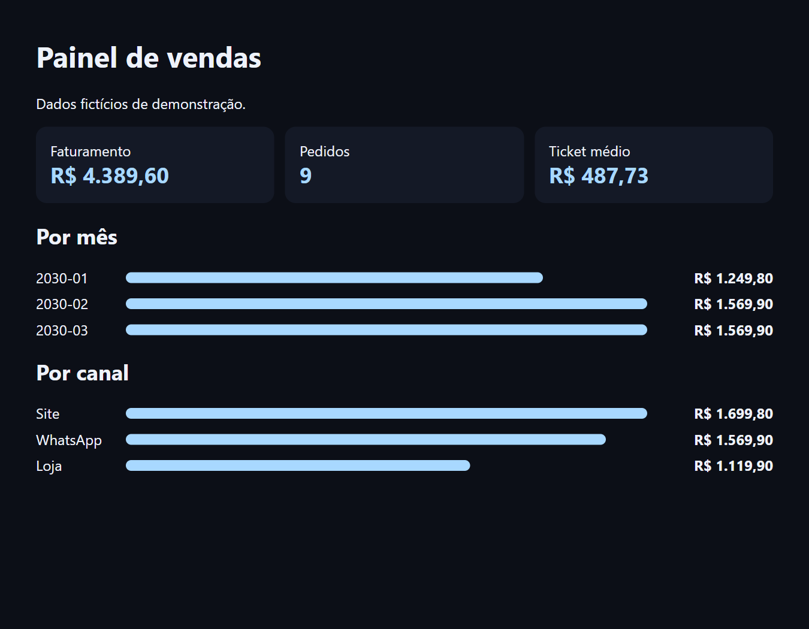
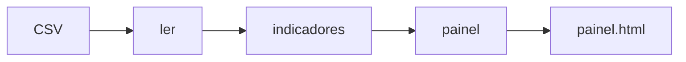

# Painel de vendas

Transforma um CSV de vendas em um painel HTML com faturamento, ticket médio e comparações por mês e por canal.

 

## Veja funcionando



*Painel gerado a partir do CSV de exemplo.*

## O problema

Muitas empresas exportam vendas para planilhas e remontam os mesmos indicadores à mão toda semana. Esse trabalho é repetitivo e abre espaço para erro. Um relatório que se monta sozinho devolve esse tempo e garante que todos olhem para o mesmo número.

## O que ele faz

- Lê o arquivo `dados/vendas.csv`.
- Calcula faturamento, número de pedidos e ticket médio.
- Agrupa as vendas por mês e por canal.
- Gera um `painel.html` que abre em qualquer navegador, sem servidor.

## Como funciona



Formato esperado do CSV:

```csv
data,canal,produto,valor
2030-01-05,Site,Plano Mensal,129.90
```

## Decisões técnicas

| Decisão | Motivo |
| --- | --- |
| Cálculo separado da apresentação | Os indicadores são testados sem gerar HTML, e o mesmo cálculo serviria para outro formato. |
| HTML único e sem dependências | O relatório pode ser enviado por e-mail ou publicado em qualquer lugar. |
| `html.escape` nos rótulos | Texto vindo do CSV não vira código na página. |
| Lista vazia tratada | Um período sem vendas não derruba o relatório. |

## Como rodar

```bash
python painel.py
python painel.py caminho/do/arquivo.csv
python -m unittest
```

## Próximos passos

- Comparar com o período anterior.
- Ler direto do banco de dados.
- Agendar a geração e o envio.

## Sobre este projeto

Projeto de demonstração, com dados e empresas fictícios, criado para mostrar a abordagem técnica de forma simples.

## Autor

**Luiz Renato Carvalho**, Engenheiro de Software e IA · [luizrenato.dev](https://www.luizrenato.dev) · [LinkedIn](https://linkedin.com/in/luizrenatodc)
